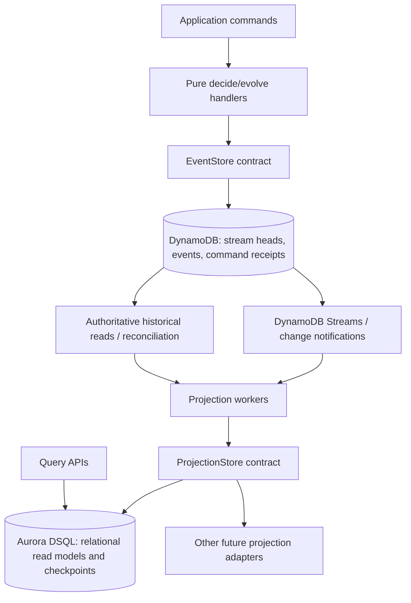

# Architecture specification

**Version:** 0.1 (draft)  
**Decision baseline:** 2026-10-25

## 1. Objective

EventSpindle is a small standalone TypeScript/Node.js event-sourcing framework, inspired by Emmett's core ideas. Event Modeling provides the scenario-driven language for defining and testing framework behavior.

## 2. Logical architecture

**Acceptance note:** The diagram is a target topology, not a guarantee of successful historical/live handoff. Stream discovery, reconciliation, and safe cutover need further design.

## 3. Component responsibilities

### Domain / command handler
- Load an aggregate's history in stream-version order.
- Reconstitute state with a pure `evolve` function.
- Evaluate business command with a pure `decide` function.
- Append only the resulting immutable domain events using expected-version semantics.
- Return typed domain failures separately from infrastructure failures.

### DynamoDB event store (accepted)
- Source of truth for all committed domain events.
- Atomic append batch, stream-head version update, and durable command receipt (receipt mechanism proposed; detailed schema pending).
- No global shared counter in the write path.
- Each event has a stable event ID, stream ID/version, event type/version, payload, metadata, and informational recorded timestamp.

### Notification / discovery (proposed)
- DynamoDB Streams informs processors of committed changes; events remain authoritative in DynamoDB.
- Delivery is at least once and not assumed globally ordered.
- Reconciliation must recover events missed by notifications or expired from stream retention.
- Candidate: transactional outbox notification per append batch; not yet decided.

### Projection runtime
- Supports a declared processing-order policy: per-stream ordering or commutative/idempotent multi-stream updates initially.
- Maintains durable progress, deduplicates already-applied events, handles gaps and recovery.
- Allows rebuilds in separate projection instances before cutover.
- Projection application and checkpoint must be committed together where adapter transactions support it.

### Projection stores (accepted)
- Defined through a pluggable abstraction; initial relational adapter is Aurora DSQL.
- Read models are asynchronously derived from DynamoDB events and therefore eventually consistent.
- Framework does not require all projections to use DSQL.

## 4. Consistency and ordering guarantees

| Dimension | Guarantee / expectation | Status |
|---|---|---|
| Per-stream event order | Contiguous `streamVersion`: 1, 2, ... | Accepted design requirement |
| Per-stream concurrency | Expected-version conditional transaction | Accepted design requirement |
| Cross-stream order | Timestamp ordering is sufficient for intended use cases; deterministic event-ID tie-breaker | Accepted requirement |
| Exact global commit order | Not promised | Explicitly not required |
| Global event counter | Absent from append path | Accepted |
| Event timestamp | May precede actual commit; not an authoritative cursor | Accepted caveat |
| Event delivery | At-least-once; duplicates and reordering tolerated | Design requirement |
| Completeness | Must be established by durable history/discovery/reconciliation, not timestamps alone | Design requirement, mechanism open |
| DynamoDB-to-DSQL atomicity | None; eventual consistency between stores | Architectural consequence |
| Projection-effect idempotency | Checkpoint and data modification atomic within sink when possible | Proposed contract |

## 5. Timestamp policy (proposed)

- Store `recordedAt` as a UTC ISO-8601 timestamp, explicitly representing application-side preparation/recording time rather than database commit time.
- Optionally store `occurredAt` for domain/source occurrence time.
- For deterministic cross-stream sorting, use `(recordedAt, eventId)` as a *display and discovery* order, not a commit-order guarantee.
- Intra-stream replay always sorts by `streamVersion`; timestamps do not override it.
- No projector may use only `recordedAt > lastTimestamp` as proof of complete processing. Late-arriving and late-visible records must be handled.

## 6. Initial non-goals

- Strict global serialization of all domain events.
- Native global `readAll(afterSequence)` promise.
- Full saga/orchestration engine.
- Universal query ORM.
- Multi-Region active/active authoritative writes (requires separate consistency design).

## 7. Likely AWS deployment

- TypeScript handlers deployed in an AWS compute environment selected by the application.
- DynamoDB table for authoritative events.
- DynamoDB Streams notification consumer, likely Lambda.
- Aurora DSQL for first relational projections and projection progress.
- S3 snapshot/export and longer-retention transport may be added for large replays, subject to verified snapshot-to-live correctness.

## 8. Key risk

A time range is not a complete replay cursor. Stream notifications may arrive out of order, a timestamp may be assigned before commit, and a GSI is eventually consistent. The framework must explicitly solve **complete stream discovery and reliable catch-up** before promising a correct cross-stream rebuild.

## v0.3 model-to-runtime integration

Event Modeling specifications are validated into a provider-neutral intermediate model. Focused AI skills use it to generate TypeScript deciders, command handlers, projection adapters, Lambda Durable Functions for Automation slices, model-derived acceptance tests, and source-controlled TypeScript AWS CDK using reusable `@eventspindle/aws-cdk` constructs. AWS-specific deployment settings are separate from the business model. Command/event persistence guarantees and projection checkpoints remain authoritative regardless of Lambda durable execution checkpoints. See [MODEL-TO-CODE.md](MODEL-TO-CODE.md).

## v0.4 — Immutable slice versions

Released Event Modeling slices are versioned and immutable. New behavior is represented as a successor slice version (e.g. `fulfill-order@2`) with its own model snapshot, digest, TypeScript implementation and generated CDK. Business slice versions are distinct from event schema versions and AWS deployment revisions. Automations retain version-pinned durable executions; state views can rebuild v2 with isolated DSQL state and checkpoints while v1 continues serving traffic. Active-version routing changes apply to new work only. See [SLICE-VERSIONING.md](SLICE-VERSIONING.md) and [ADR-008](adr/ADR-008-immutable-slices.md).
